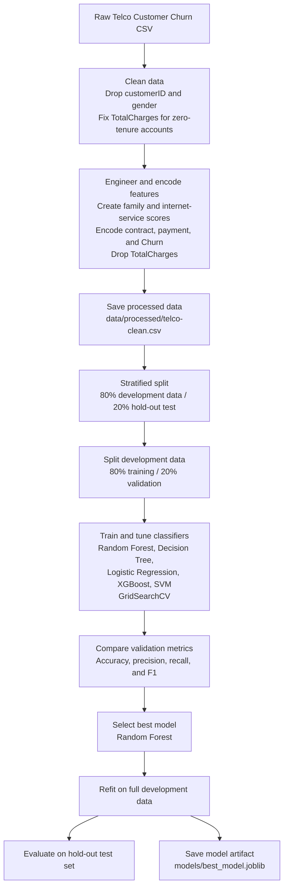

# Telco Customer Churn Prediction

This project builds a machine learning solution to predict whether a telecom customer is likely to churn. The workflow includes exploratory data analysis (EDA), feature engineering, model comparison and tuning, and a small Streamlit application for live predictions.

## Project goal

Customer churn is a major business problem in telecom because it directly affects revenue and retention. The goal of this project is to identify customers at risk of leaving and provide a tool that can support retention strategies.

## Dataset

The project uses the IBM Telco Customer Churn dataset, which contains customer demographics, account information, services, billing details, and a churn label.

Key characteristics included in the raw data:
- customer profile and tenure
- internet service type and add-on services
- contract type and billing behavior
- monthly charges and payment method
- family status and churn label

## What was done in the EDA notebook

The notebook `eda.ipynb` was used to understand the structure of the dataset and prepare it for modeling.

### Data cleaning and preprocessing
- Removed unnecessary identifiers such as `customerID`
- Dropped weak or redundant features such as `gender`
- Converted categorical yes/no values into numeric codes
- Handled the `tenure = 0` case by setting `TotalCharges` to the monthly charge for new accounts
- Encoded service and billing categories into numeric representations

### Feature engineering
- Created `family_score` from `Partner` and `Dependents`
- Created `Internet_service_score` based on add-on services such as:
  - Tech support
  - Device protection
  - Online backup
  - Online security
- Encoded contract type as ordinal values:
  - Month-to-month = 0
  - One year = 1
  - Two year = 2
- Converted `PaymentMethod` into a binary feature for electronic check usage
- Converted the target `Churn` column to numeric values (`Yes` = 1, `No` = 0)

### Exploratory findings
- Monthly charges and tenure were strongly associated with churn risk
- `TotalCharges` was highly correlated with `tenure`, so it was removed to reduce multicollinearity
- Customers with month-to-month contracts and higher monthly charges showed higher churn likelihood
- Internet service and contract status were key predictors in the churn pattern

### Final cleaned dataset
The processed dataset is saved to:
- `data/processed/telco-clean.csv`

### Engineered feature schema

The processed CSV contains nine model input features and the `Churn` target:

| Column | Type | Definition / encoding |
|---|---|---|
| `SeniorCitizen` | Integer | Senior-citizen indicator: `1` = yes, `0` = no |
| `tenure` | Integer | Length of the customer relationship, in months |
| `InternetService` | Integer | `0` = no internet service, `1` = DSL, `2` = fiber optic |
| `Contract` | Integer | `0` = month-to-month, `1` = one year, `2` = two year |
| `PaperlessBilling` | Integer | `1` = yes, `0` = no |
| `MonthlyCharges` | Float | Customer's monthly charges |
| `family_score` | Integer | `Partner` + `Dependents`, each encoded as yes = `1`, no = `0`; range `0`-`2` |
| `Internet_service_score` | Float | Sum of TechSupport, DeviceProtection, OnlineBackup, and OnlineSecurity; yes = `1`, no = `0`, no internet service = `-0.25` per add-on (score `-1` when there is no internet service) |
| `Payment_Electronic_check` | Integer | `1` = electronic check, `0` = any other payment method |
| `Churn` (target) | Integer | `1` = churn, `0` = no churn |

## Data preparation and modeling pipeline



## Project architecture

```mermaid
flowchart LR
    subgraph Training["Offline data preparation and training"]
        RAW["data/raw/<br/>Telco-Customer-Churn.csv"] --> EDA["eda.ipynb<br/>Clean and engineer features"]
        EDA --> CLEAN["data/processed/<br/>telco-clean.csv"]
        CLEAN --> MODEL["modelling.ipynb<br/>Train, tune, and evaluate"]
        MODEL --> ARTIFACT["models/<br/>best_model.joblib"]
    end

    subgraph Serving["Churn prediction application"]
        USER["User"] --> APP["Streamlit UI<br/>App.py"]
        APP --> FEATURES["Build 9-feature input vector"]
        FEATURES --> PREDICT["Predict churn class<br/>and probabilities"]
        PREDICT --> RESULT["Display churn status<br/>and probability breakdown"]
        RESULT --> USER
    end

    ARTIFACT --> LOAD["Load trained model<br/>with joblib"]
    LOAD --> PREDICT
```



## What was done in the modeling notebook

The notebook `modelling.ipynb` focuses on building and comparing predictive models.

### Train/validation/test setup
- The dataset was split into train, validation, and test sets
- Stratification was used to preserve class balance
- Model performance was evaluated using accuracy, precision, recall, F1-score, and classification reports

### Models compared
The following classifiers were evaluated:
- Random Forest
- Decision Tree
- Logistic Regression
- XGBoost
- SVM

### Hyperparameter tuning
- GridSearchCV was used for model tuning
- Multiple scoring metrics were considered, with F1/recall prioritized depending on the model

### Best model selected
The best-performing model was a Random Forest classifier, which was selected as the final production model.

The final model is saved as:
- `models/best_model.joblib`

### Final evaluation on unseen test data
The final model was evaluated on the hold-out test set with results approximately as follows:
- Accuracy: 73.4%
- Precision: 49.9%
- Recall: 80.2%
- F1-score: 61.5%

This indicates that the model is effective at detecting customers likely to churn, especially with strong recall for the churn class.

## What was built in the app

The file `App.py` contains a Streamlit web application for customer churn prediction.

### Functionality
- User enters customer details
- Model loads the trained Random Forest classifier
- The app constructs the required feature vector
- Prediction is made and the churn probability is shown
- The user sees:
  - predicted churn status
  - confidence score
  - probability breakdown for churn vs. non-churn

### Example inputs in the app
- senior citizen flag
- tenure in months
- internet service type
- contract type
- paperless billing flag
- monthly charges
- family score
- internet add-on score
- electronic check payment indicator

## Project structure

```text
Capstone-Project---IBM-telco-customer-churn/
├── App.py
├── README.md
├── requirements.txt
├── eda.ipynb
├── modelling.ipynb
├── data/
│   ├── raw/
│   └── processed/
├── models/
│   └── best_model.joblib
```

## How to run the project

### Install dependencies
```bash
pip install -r requirements.txt
```

### Run the Streamlit app
```bash
streamlit run App.py
```

## Summary

This project combines data analysis, business insight, machine learning, and deployment into a practical churn prediction solution. It demonstrates a full workflow for telecom churn prediction, from raw dataset exploration through cleaned feature engineering, model selection, and a user-facing prediction app.


